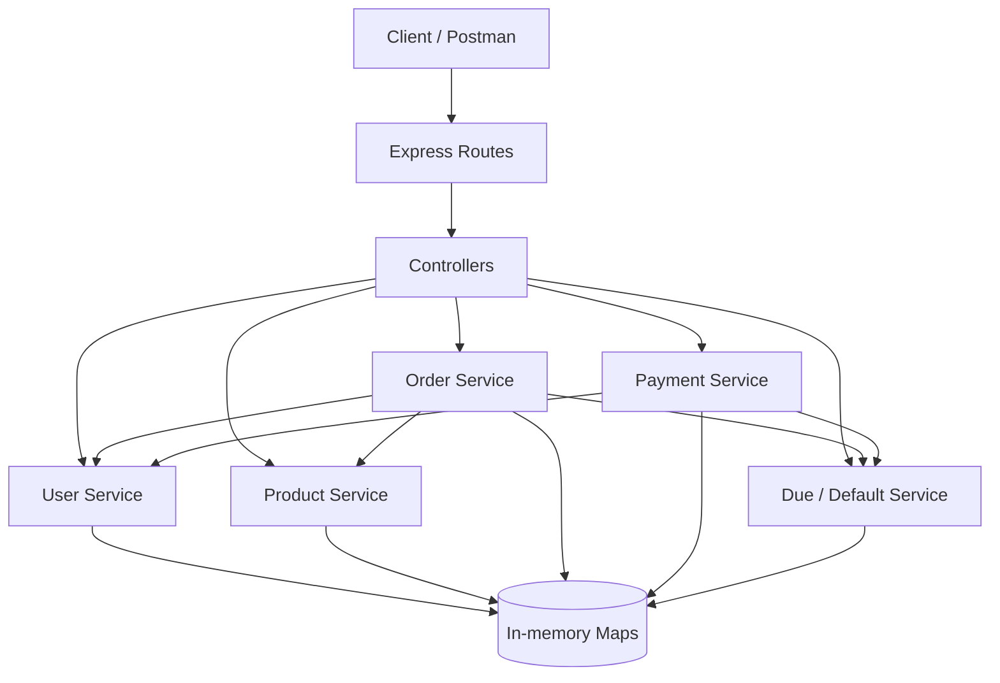
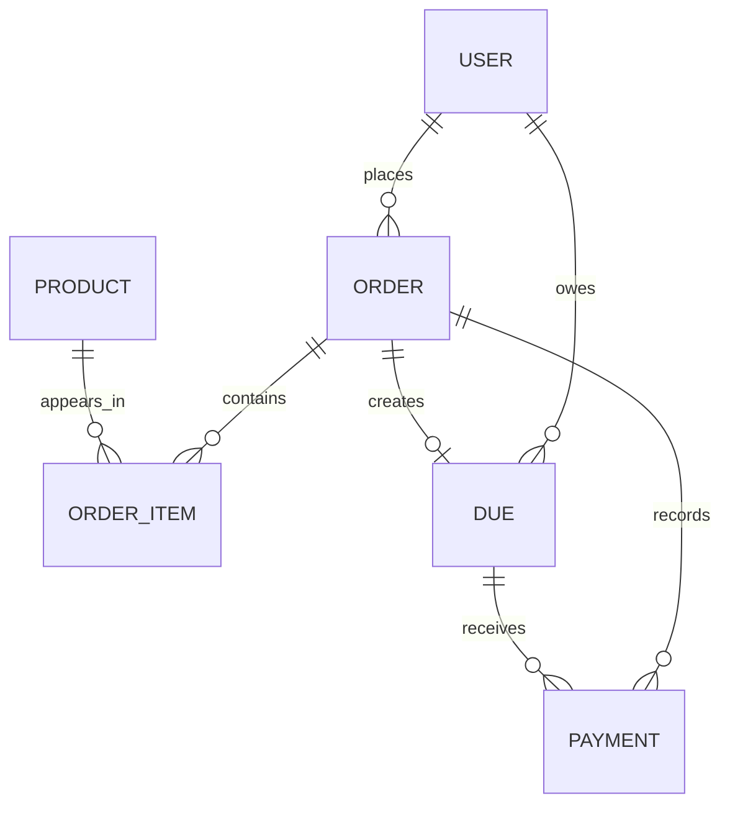
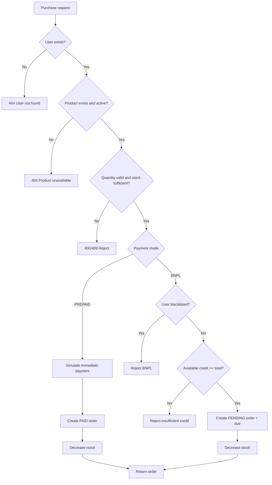
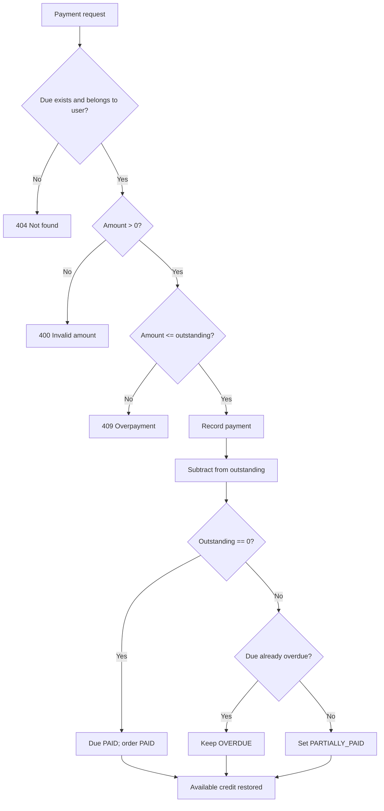

# System Design & Data Model

## 1. Architecture

Use a layered, modular monolith. Keep business logic independent from Express so it can be tested directly and reused by routes.



## 2. Suggested folder structure

```text
paylater-bnpl-system/
├── docs/
│   ├── PRD.md
│   ├── SYSTEM_DESIGN.md
│   └── API_DOCUMENTATION.md
├── src/
│   ├── app.js
│   ├── server.js
│   ├── config/
│   │   └── constants.js
│   ├── controllers/
│   ├── routes/
│   ├── services/
│   │   ├── user.service.js
│   │   ├── product.service.js
│   │   ├── order.service.js
│   │   ├── payment.service.js
│   │   └── due.service.js
│   ├── repositories/
│   │   └── memory-store.js
│   ├── utils/
│   │   ├── errors.js
│   │   ├── id.js
│   │   └── money.js
│   └── validators/
├── tests/
├── .gitignore
├── package.json
└── README.md
```

## 3. In-memory data model

Use one Map per entity. IDs are strings generated with `crypto.randomUUID()`.

### User

```js
{
  id: "usr_...",
  name: "Aarav",
  creditLimit: 1000000, // ₹10,000 in paise
  status: "ACTIVE",     // ACTIVE | BLACKLISTED
  defaultCount: 0,
  createdAt: "ISO-8601"
}
```

### Product

```js
{
  id: "prd_...",
  name: "Headphones",
  price: 250000, // ₹2,500 in paise
  stock: 10,
  active: true,
  createdAt: "ISO-8601"
}
```

### Order

```js
{
  id: "ord_...",
  userId: "usr_...",
  items: [{
    productId: "prd_...",
    productName: "Headphones", // snapshot at purchase time
    unitPrice: 250000,
    quantity: 1,
    lineTotal: 250000
  }],
  totalAmount: 250000,
  paymentMode: "BNPL", // PREPAID | BNPL
  status: "PENDING",
  dueId: "due_...",    // null for PREPAID
  createdAt: "ISO-8601"
}
```

### Due

```js
{
  id: "due_...",
  orderId: "ord_...",
  userId: "usr_...",
  originalAmount: 250000,
  outstandingAmount: 250000,
  dueDate: "ISO-8601",
  status: "PENDING",
  defaultedAt: null, // set once; prevents duplicate default count
  createdAt: "ISO-8601",
  paidAt: null
}
```

### Payment

```js
{
  id: "pay_...",
  dueId: "due_...",
  orderId: "ord_...",
  userId: "usr_...",
  amount: 50000,
  method: "SIMULATED",
  createdAt: "ISO-8601"
}
```

## 4. Store definition

```js
export const store = {
  users: new Map(),
  products: new Map(),
  orders: new Map(),
  dues: new Map(),
  payments: new Map()
};
```

A Map provides direct lookup by ID in average O(1) time. For user history, scan orders/dues/payments and filter by `userId`; this is O(n), acceptable for an in-memory exercise.

## 5. Entity relationships



Each BNPL order creates exactly one due in v1. PREPAID orders do not create dues.

## 6. Purchase flow



**Important:** Calculate and validate everything before mutating any Map. In the single-process exercise, keep the validation and mutation together in one synchronous service method. For a multi-item cart, validate stock for every line before decrementing any product.

## 7. Credit calculation

Recommended source of truth:

```js
function getOutstandingForUser(userId) {
  let total = 0;

  for (const due of store.dues.values()) {
    if (due.userId === userId && due.outstandingAmount > 0) {
      total += due.outstandingAmount;
    }
  }

  return total;
}

function getAvailableCredit(userId) {
  const user = store.users.get(userId);
  const outstanding = getOutstandingForUser(userId);
  return user.creditLimit - outstanding;
}
```

A due remains outstanding even after it becomes overdue or defaulted. Defaulting does not forgive debt.

## 8. Repayment flow



The credit restoration is not a separate arbitrary adjustment: it follows automatically because available credit is calculated from the reduced outstanding balance.

## 9. Overdue and default algorithm

```js
function evaluateOverdue(now = new Date()) {
  for (const due of store.dues.values()) {
    if (due.outstandingAmount <= 0) continue;
    if (new Date(due.dueDate) >= now) continue;

    due.status = "OVERDUE";

    // Count this due only once.
    if (due.defaultedAt === null) {
      due.defaultedAt = now.toISOString();

      const user = store.users.get(due.userId);
      user.defaultCount += 1;

      if (user.defaultCount >= 3) {
        user.status = "BLACKLISTED";
      }
    }

    const order = store.orders.get(due.orderId);
    if (order && order.status !== "PAID") {
      order.status = "OVERDUE";
    }
  }
}
```

Inject `now` in tests. A partial repayment after default reduces outstanding but does not erase the historical default. If the due is fully paid, set it to PAID; keep `defaultedAt` as historical audit data.

## 10. State transition summary

### Due

```text
PENDING ──partial payment──> PARTIALLY_PAID
PENDING ──due date passes──> OVERDUE
PARTIALLY_PAID ──due date passes──> OVERDUE
PENDING / PARTIALLY_PAID / OVERDUE ──full repayment──> PAID
OVERDUE ──partial repayment──> OVERDUE
```

### User

```text
ACTIVE ──3 distinct defaulted dues──> BLACKLISTED
BLACKLISTED ──repayment──> BLACKLISTED (v1; manual review/reactivation out of scope)
```

## 11. Complexity

| Operation | Expected complexity |
|---|---:|
| Get user/product/due by ID | O(1) average |
| Create entity in Map | O(1) average |
| Calculate outstanding credit by scanning dues | O(D) |
| User order history by scanning orders | O(O) |
| Evaluate all dues | O(D) |
| List all products | O(P) |

Where D = number of dues, O = number of orders, and P = number of products.

## 12. Engineering notes

- Store money as integer paise, not JavaScript floating-point rupees.
- Use `Number.isSafeInteger` and validate amount bounds.
- Use a clock abstraction for deterministic date tests.
- Keep status constants centralized.
- Use a product-name and unit-price snapshot on order items so later product edits do not rewrite history.
- For a cart, validate every product and stock quantity before changing any stock.
- In-memory Maps are not durable and are not safe for multiple server processes. These limitations are intentional in this exercise.
